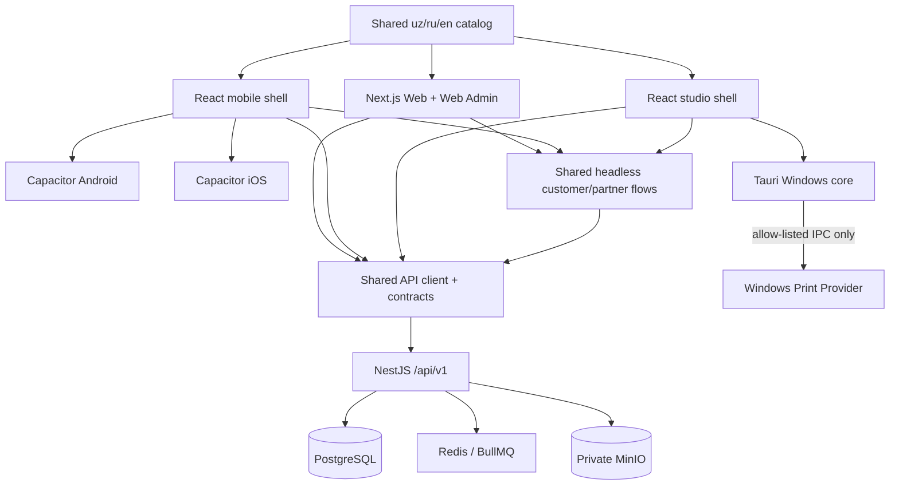

# AGAT PRINT — стратегия мультиплатформенных приложений

Статус: архитектурная рекомендация для согласования, без реализации.  
Дата: 2026-10-12.  
Baseline: `main` на `6cbf28b8fcb21ba9a6509dca34d4832416795dd7`, Stage 1–15.

## 1. Решение

AGAT PRINT следует развивать как одну платформу с единым NestJS API и пятью
клиентскими поверхностями:

| Поверхность | Рекомендация                             | Назначение                                              |
| ----------- | ---------------------------------------- | ------------------------------------------------------- |
| Web         | сохранить Next.js PWA                    | полный клиентский путь без установки                    |
| Android     | отдельный React-клиент в Capacitor       | Google Play, камера, системный выбор файлов, deep links |
| iOS         | тот же React-клиент в Capacitor          | App Store, камера, Files, Universal Links               |
| Windows     | Tauri 2 + React, нативный print boundary | рабочее место студии и оператора печати                 |
| Web Admin   | сохранить Next.js admin routes           | управление платформой, без встраивания в mobile         |

Это не пять реализаций бизнес-логики. Домен, цены, заказы, платежи, статусы,
matching, production и fulfillment остаются только в API/PostgreSQL. Клиенты
получают общие типизированные контракты, presentation state и UI-компоненты, но
не принимают авторитетных бизнес-решений.

Прямо упаковывать текущий Next.js сайт в WebView не рекомендуется. Текущий Web
build использует Next runtime, cookie/CSRF transport и browser navigation; он не
выдаёт статический bundle для Capacitor/Tauri. Кроме того, простая оболочка над
сайтом несёт риск отклонения App Store как repackaged website. Capacitor при
этом подходит как native runtime для Android/iOS, если оболочка получает
реальные нативные возможности и использует вынесенный общий клиентский слой.

Для Windows рекомендуется Tauri, а не Electron. Electron быстрее переиспользует
Node-код printer-agent, но приносит отдельный Chromium/Node runtime, больший
дистрибутив и более широкую поверхность обновлений. Tauri даёт меньший runtime,
явные IPC capabilities и удобный путь к Windows Credential Manager и Print
Spooler. Цена выбора — Rust/native компетенция и необходимость вынести протокол
существующего TypeScript printer-agent из его CLI-цикла.

## 2. Фактическая готовность Stage 1–15

### Что уже хорошо подготовлено

- NestJS modular monolith и `/api/v1` — единый доменный backend.
- PostgreSQL — единственный источник истины; Redis остаётся транспортом очередей.
- Черновики, корзины, заказы, timeline и уведомления уже серверные и
  owner-scoped. Поэтому заказ можно продолжить на другом устройстве после входа.
- Все деньги, matching, payment, production и fulfillment server-authoritative.
- OpenAPI, `@agat/contracts`, provider ports, outbox/inbox, idempotency и CAS
  дают основу для нескольких клиентов без второй state machine.
- Upload sessions, private MinIO, preview/print-ready, no-store и signed URL
  discipline пригодны для native-клиентов.
- Клиентская презентация имеет bounded locale `uz | ru | en`, а locale не
  влияет на коммерческое состояние.
- Printer-agent уже имеет machine identity, lease/CAS, PDF validation и
  атомарную spool-directory boundary.
- Web Admin и partner/admin RBAC уже существуют в Next/Nest.

### Пробелы, которые блокируют качественные native-приложения

| Область          | Текущее состояние                                                          | Необходимое изменение                                                                                        |
| ---------------- | -------------------------------------------------------------------------- | ------------------------------------------------------------------------------------------------------------ |
| Auth transport   | Только HttpOnly cookies, CSRF и один `WEB_ORIGIN`                          | Отдельный native session profile с bearer access token в памяти и rotating refresh token в OS secure storage |
| API client       | Ручной `fetch`, web-cookie assumptions                                     | Генерируемый/проверяемый API SDK и transport adapters для web/native/desktop                                 |
| UI reuse         | Next pages смешивают orchestration, navigation и copy                      | Вынести headless flows, schemas, i18n и reusable components в packages                                       |
| Localization     | Три locale существуют, но часть страниц содержит локальные RU/UZ ternaries | Централизовать весь customer/partner copy; compile-time completeness для `uz/ru/en`                          |
| Upload           | Один foreground `PUT` до 25 МБ                                             | Native URI streaming и resumable/chunk contract с checksum и безопасным resume                               |
| Device lifecycle | Нет модели установки/устройства                                            | Device installation, session inventory, revocation и optional push endpoint                                  |
| Push             | Только durable in-app notifications                                        | Provider-neutral push port + FCM/APNs adapters; PostgreSQL остаётся источником истины                        |
| Deep links       | Web URLs без association files                                             | Universal Links/App Links с allow-list маршрутов и login-resume                                              |
| Windows app      | Headless Node CLI, env token, spool folder                                 | Signed desktop shell, operator RBAC, OS credential store, updater и restricted native print commands         |
| Local printing   | Валидированный PDF только кладётся в spool directory                       | Windows print provider port; spool-folder adapter остаётся безопасным fallback/test adapter                  |
| Store readiness  | Нет native projects/metadata/signing/privacy manifests                     | Android/iOS projects, permissions, disclosures, signing and release runbooks                                 |
| Native CI        | Проверяется Web/Chromium                                                   | Android emulator, iOS simulator и Windows installer/smoke gates                                              |

### Оценка по платформам

- **Web client — высокая готовность.** Полный Stage 11–15 flow уже работает;
  нужны API/client extraction и дальнейшая доступность.
- **Web Admin — высокая готовность.** Сохраняется как browser-only surface;
  мобильная административная оболочка не нужна для MVP.
- **Android/iOS — средняя готовность домена, низкая готовность поставки.** Все
  бизнес-возможности есть, но отсутствуют native session, bundle, secure storage,
  camera/file bridge, deep links, push registration и store pipeline.
- **Windows — средняя готовность протокола, низкая готовность продукта.** API и
  lease/spool invariants есть, но нет GUI, branch-operator membership, installer,
  code signing, secure enrollment и настоящего Windows spool adapter.

## 3. Целевая архитектура

Предлагаемая структура монорепо:

- `apps/web` — существующие Next.js Web и Web Admin;
- `apps/mobile` — static React/Vite application shell;
- `apps/mobile/android`, `apps/mobile/ios` — Capacitor native projects;
- `apps/studio-desktop` — Tauri/React Windows application;
- `apps/printer-agent` — совместимый headless deployment, пока desktop rollout
  не доказан;
- `packages/api-client` — OpenAPI-derived DTO/client плюс redacted errors;
- `packages/customer-flow` — state/view models, resume and conflict recovery;
- `packages/ui` — framework-neutral React components where practical;
- `packages/i18n` — полный `uz/ru/en` catalog с проверкой одинаковых ключей;
- `packages/platform` — camera/files/secure-storage/deep-link/notification ports;
- `packages/printer-protocol` — machine API protocol and invariant tests.

Следует делить не страницы, а поведение. Next router, Capacitor lifecycle и Tauri
IPC останутся platform-specific. Shared packages не должны импортировать Next,
Capacitor или Tauri.

## 4. Сессии и синхронизация между устройствами

Web продолжает использовать HttpOnly/Secure/SameSite cookies и CSRF без
изменения Stage 1–15. Native приложения используют отдельные endpoints того же
identity module:

1. OTP request/verify остаются provider-neutral и используют существующие TTL,
   attempts, rate limits и replay protection.
2. Native verify выдаёт короткий access token и одноразово rotating refresh
   token. Access token хранится только в памяти; refresh token — только Android
   Keystore/iOS Keychain/Windows Credential Manager.
3. В PostgreSQL по-прежнему хранится только digest refresh token. Session family,
   rotation и reuse detection общие с Web; добавляются bounded `clientType`,
   installation reference и last-seen metadata без fingerprinting.
4. Cookie endpoints остаются CSRF-protected. Native bearer endpoints не
   принимают cookie authority и не используют `Origin` как идентичность.
5. Logout/reuse revokes session family. Пользователь видит список своих
   установок и может отозвать отдельную сессию.
6. Draft/basket/order загружаются из API после login. Локально разрешено хранить
   только несекретный UI cache; version/CAS conflict вызывает refetch и понятный
   recovery flow.

Так пользователь начинает заказ в Web и продолжает его на Android/iOS без
переноса локальных IDs, signed URLs или файловых путей. Незавершённый локальный
upload — исключение: приложение показывает, что файл надо выбрать повторно,
если bytes ещё не были подтверждены сервером.

## 5. Файлы, камера и upload

- Web сохраняет `<input type=file>` и существующий protected pipeline.
- Mobile использует system photo/file picker и camera capture через Capacitor
  plugins; разрешения запрашиваются только в момент действия, без broad gallery
  access.
- Native bridge передаёт stream/URI в upload transport, не base64 в JavaScript.
- Resumable upload должен иметь immutable session, numbered chunks/checksums,
  total length, expiry and finalization CAS. Finalization запускает ровно тот же
  signature/MIME/AV/quarantine pipeline Stage 3.
- Temporary captures находятся в private app sandbox и удаляются после server
  acknowledgement/cancel/expiry. Filename, EXIF location and local path не
  попадают в audit/metrics/logs. Для фото следует явно удалять лишний EXIF до
  upload либо доказать server-side stripping до permanent storage.
- Preview остаётся short-lived/no-store. Native clients не пишут preview или
  signed URL в shared photo gallery, analytics или backup.

## 6. Уведомления и deep links

`UserNotification` и order timeline остаются авторитетными. Push — только wake-up
hint с bounded event code и opaque notification ID, без телефона, адреса, цены,
имени файла, order details или signed URL.

- `DeviceInstallation` принадлежит пользователю и платформе;
- push token хранится зашифрованным, ротируется и удаляется при logout/revoke;
- `PushProvider` имеет FCM и APNs adapters, retry/outbox/inbox и fail-closed
  configuration;
- без provider credentials приложение полностью работает через polling/in-app
  notifications;
- Universal Links/App Links открывают только allow-listed customer routes и
  после auth заново проверяют ownership;
- association files публикуются на основном HTTPS domain.

## 7. Windows studio/operator application

### Рекомендуемая модель

Tauri 2 показывает partner offers, active assignment, itemized production jobs,
download/print status and manual READY transition. Tauri Rust core владеет:

- Windows Credential Manager access;
- machine enrollment/token rotation;
- download во временную private directory;
- повторной PDF signature/size/hash validation;
- ограниченным Windows print/spool provider;
- atomic cleanup, lease heartbeat and bounded local diagnostics;
- signed update verification.

WebView не получает machine token, signed URL, filesystem wildcard или generic
shell execution. IPC commands имеют allow-list, typed payloads и branch/job
scope. Партнёрская user session и printer-agent machine identity остаются
раздельными полномочиями.

Существующий `apps/printer-agent` сохраняется как headless fallback. Его API
protocol и tests выносятся в shared package; бизнес-статусы не дублируются.
Stage 16 test build использует spool-directory/virtual printer adapter. Реальные
драйверы, paper trays, color profiles and vendor SDK требуют hardware matrix и
отдельной сертификации.

### Tauri против Electron

| Критерий                          | Tauri 2                        | Electron                                       |
| --------------------------------- | ------------------------------ | ---------------------------------------------- |
| Размер/runtime                    | системный WebView2, меньше     | bundled Chromium/Node, больше                  |
| Security boundary                 | explicit Rust/IPC capabilities | требует особенно строгой изоляции Node/context |
| Переиспользование agent Node code | нужно вынесение/sidecar        | проще                                          |
| Windows native integration        | Rust/Win32 plugins             | Node native modules                            |
| Обновления runtime                | WebView2 обслуживается ОС      | Chromium обновляется с приложением             |
| Рекомендация                      | **выбран**                     | fallback только при доказанном blocker Tauri   |

## 8. Store, signing и policy constraints

### Android / Google Play

- На дату документа новые приложения и updates должны target Android 16 / API
  36 с 31 августа 2026 года; это проверяется перед каждой release branch.
- Release — AAB с Play App Signing; debug APK создаётся только для пилота.
- Нужны organization developer account, verified contacts, privacy policy,
  accurate Data Safety declaration и in-app + web account deletion request.
- Camera/files/notifications permissions должны быть минимальны и соответствовать
  фактическому поведению и disclosures.

### iOS / App Store

- Нужны macOS/Xcode, Apple Developer Program, bundle identifier, certificates,
  provisioning, privacy declarations and review metadata.
- App должна превосходить «переупакованный сайт»: native picker/camera, secure
  session, deep links, resilient resume and notifications дают app-like utility.
- Account creation требует initiation of account deletion in-app; юридически
  обязательные financial records могут сохраняться только с прозрачным
  объяснением срока.
- Camera/photo usage descriptions локализуются; privacy answers включают
  собственный backend и каждый SDK.

### Windows

- Test installer может быть unsigned и явно помечен internal-only.
- Commercial installer и updater требуют organization code-signing certificate,
  защищённого CI signing key, timestamping and signed update manifest.
- Поддерживаемая база — Windows 10/11 с WebView2. Windows 7 не входит.

Актуальные первичные источники:

- [Capacitor supported targets and build requirements](https://capacitorjs.com/docs/getting-started/environment-setup)
- [Capacitor deep links](https://capacitorjs.com/docs/guides/deep-links)
- [Apple App Review Guidelines, minimum functionality](https://developer.apple.com/app-store/review/guidelines/)
- [Apple app privacy](https://developer.apple.com/help/app-store-connect/manage-app-information/manage-app-privacy)
- [Apple in-app account deletion](https://developer.apple.com/support/offering-account-deletion-in-your-app/)
- [Google Play target API requirements](https://support.google.com/googleplay/android-developer/answer/11926878)
- [Google Play Data Safety](https://support.google.com/googleplay/android-developer/answer/10787469)
- [Google Play account deletion](https://support.google.com/googleplay/android-developer/answer/13327111)
- [Tauri security model](https://v2.tauri.app/security/)
- [Tauri external binaries](https://v2.tauri.app/develop/sidecar/)
- [Tauri Windows signing](https://v2.tauri.app/distribute/sign/windows/)

Store rules are operational dependencies, not frozen code assumptions. Release
runbooks must re-check them before every submission.

## 9. Security baseline for all clients

1. TLS only; optional certificate pinning is not the primary trust control and
   must have a safe rotation strategy if introduced.
2. No secrets in JavaScript storage, SQLite, browser cache, app logs, crash
   reports, notification payloads or OS recent-file lists.
3. Platform bridge exposes least privilege only. No generic shell, arbitrary
   filesystem, arbitrary URL fetch or printer selection command from WebView.
4. All native dependencies/plugins enter the existing dependency audit/SBOM
   and release provenance gate, including Gradle, CocoaPods/SPM and Cargo.
5. Rooted/jailbroken device detection, Play Integrity or App Attest may be risk
   signals, never sole authorization. Server ownership/RBAC stays mandatory.
6. API returns bounded localized error codes; client maps them through complete
   `uz/ru/en` catalogs. Internal enums and raw provider errors are not UI copy.
7. Web and native session mechanisms are separated and downgrade-tested.
8. Remote content cannot acquire native capabilities. CSP, navigation allow-list,
   IPC scopes and deep-link validation are mandatory.
9. Mobile/desktop telemetry follows existing bounded-label policy. Installation
   or crash correlation IDs never become metric labels.

## 10. Test and release strategy

### Continuous verification

- existing Stage 1–15 sequential regression remains unchanged;
- OpenAPI compatibility and generated SDK drift check;
- unit tests for shared flows, locale completeness and platform ports;
- API DB-E2E for native session rotation/reuse/revocation and cross-device resume;
- Android emulator E2E for OTP, file/camera fixture, upload, draft resume and order;
- iOS simulator compile/unit/E2E on a macOS runner;
- Windows VM E2E for install, enrollment, claim/lease, safe spool and update
  signature rejection;
- dependency audit/SBOM for npm, Cargo, Gradle and iOS dependencies;
- backup/restore proves new device/session/push rows without persisting secrets;
- privacy scans inspect logs, audit, metrics and generated artifacts.

### First installable pilots

**Android:** reproducible debug APK and unsigned/non-production test AAB; install
on emulator and at least one physical device; verify `uz/ru/en`, app link, photo
picker/camera fixture, background/resume behavior and server state continuity.

**Windows:** reproducible internal MSI/NSIS installer; install/uninstall on clean
Windows 10 and 11 VMs; enroll a synthetic machine, claim a synthetic print job,
write one validated PDF to an isolated spool adapter, restart mid-lease and prove
idempotent recovery. No real customer document is used.

**iOS:** macOS CI performs simulator build/test with no signing secret. After
Apple enrollment, create Development/TestFlight signing, test on one current and
one oldest-supported device, validate camera/Files permissions, backgrounding,
Universal Links, Keychain and review metadata. App Store submission is not a
Stage 16 prerequisite unless credentials and legal artifacts are supplied.

## 11. Roadmap to MVP and commercial launch

1. **Platform foundation:** shared SDK/i18n/flows, native sessions, device
   lifecycle, Capacitor and Tauri shells, reproducible test artifacts.
2. **Internal alpha:** synthetic Android/Windows end-to-end, iOS simulator,
   security review, installer/update rollback and operational runbooks.
3. **Closed Uzbekistan pilot:** real devices and selected studios, physical
   printer matrix, network-loss tests, support process and measured SLOs.
4. **Store readiness:** legal/privacy/account deletion, organization accounts,
   signing, Data Safety/App Privacy, localized listings and accessibility.
5. **Commercial launch:** contracted OTP/acquiring/fiscal providers, production
   push credentials, code signing, off-host recovery drill, incident/on-call,
   capacity/load test and staged rollout with kill switches.

## 12. Risks and decisions required

| Risk / decision                         | Impact                                     | Response                                                              |
| --------------------------------------- | ------------------------------------------ | --------------------------------------------------------------------- |
| Current cookie-only auth                | Native clients cannot safely authenticate  | Native token profile inside existing identity module                  |
| Next pages are not portable             | Direct wrapper couples app to Next runtime | Extract headless flows/components, keep separate shells               |
| Thin-wrapper store rejection            | iOS review failure                         | Native picker/camera/deep link/resume/notifications and offline shell |
| Plugin supply-chain exposure            | Native compromise                          | Minimal audited plugins, SBOM, version pinning and capability scopes  |
| Windows machine/user identity confusion | Privilege escalation                       | Separate operator session from machine credential                     |
| Printer/driver diversity                | Field failures                             | Provider boundary, certified hardware matrix, spool fallback          |
| iOS requires macOS/signing              | Cannot validate release on Windows         | macOS CI now; TestFlight after external account/certificates          |
| Push credentials absent                 | No production push                         | In-app notifications remain complete; push externally blocked         |
| Store/legal declarations absent         | Publication blocked                        | Treat as launch checklist, never invent declarations                  |
| Existing copy not fully centralized     | Localization drift across clients          | Compile-time three-locale catalog and no inline customer copy         |

## 13. Strategy acceptance criteria

The architecture is ready for implementation only after approval of these
decisions:

- Capacitor for Android/iOS and Tauri for Windows;
- separate static client shells, not remote-site wrappers;
- one backend/domain and shared OpenAPI client;
- cookie auth retained for Web and secure rotating token profile added for
  native clients;
- platform ports and least-privilege native bridges;
- Windows operator and machine identities remain distinct;
- first artifacts are internal APK and Windows installer; iOS simulator is
  automatic, TestFlight/store work is externally gated;
- exact customer languages remain `uz`, `ru`, `en`;
- no Stage 1–15 invariant or full regression gate is weakened.
